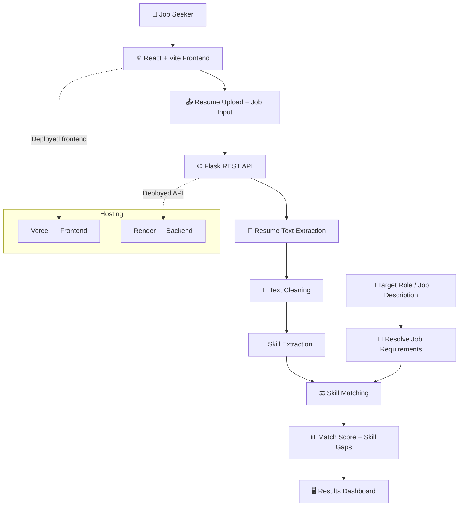

# 🚀 AI Resume Analyzer & Job Match System

<p align="center">
  <strong>Analyze your resume. Discover skill gaps. Take the next step in your career.</strong>
</p>

<p align="center">
  A full-stack web application that analyzes resumes against target roles or job descriptions, identifies relevant skills, and calculates a resume-to-job match score.
</p>

<p align="center">
  <a href="https://ai-resume-analyzer-jade-tau.vercel.app/"><strong>🌐 Live Application</strong></a> •
  <a href="https://github.com/Kritika-Si/AI-Resume-Analyzer"><strong>💻 GitHub Repository</strong></a> •
  <a href="#-getting-started"><strong>⚙️ Get Started</strong></a>
</p>

<p align="center">
  
  
  
  
  
</p>

---

## 📑 Table of Contents

- [✨ Overview](#-overview)
- [🎯 Key Features](#-key-features)
- [🧠 How It Works](#-how-it-works)
- [🏗️ System Architecture](#️-system-architecture)
- [🛠️ Technology Stack](#️-technology-stack)
- [🌐 Application Links](#-application-links)
- [📂 Project Structure](#-project-structure)
- [⚙️ Getting Started](#️-getting-started)
- [🔌 API Reference](#-api-reference)
- [🧪 Testing Checklist](#-testing-checklist)
- [⚠️ Limitations](#️-limitations)
- [🗺️ Roadmap](#️-roadmap)
- [👩‍💻 Author](#-author)

---

## ✨ Overview

Finding the right job is not only about having technical skills—it's also about understanding how your experience aligns with a role's requirements.

**AI Resume Analyzer & Job Match System** helps job seekers evaluate their resumes against a target job description or role. The application extracts resume text, identifies recognized skills, compares them with relevant job requirements, and presents the results through an interactive dashboard.

### 💡 The Problem

Job seekers may struggle to identify relevant skills, recognize gaps in their resumes, and understand how closely their profiles align with a job opportunity.

### 💻 The Solution

ResumeAI provides an accessible way to:

- 📄 Extract and inspect resume content.
- 🎯 Analyze a target role or full job description.
- 🧩 Identify recognized skills in a resume.
- 📊 Calculate a job-match percentage.
- 🔎 Discover matching and missing skills.
- 🚀 Identify areas for further learning and resume improvement.

> **Important:** The match score is an automated indicator based on the application's current matching logic. It is not a prediction of hiring success or a guarantee of passing an Applicant Tracking System (ATS).

## 🎯 Key Features

| Feature | Description |
|---|---|
| 📄 Resume Upload | Upload resumes in PDF or DOCX format. |
| 🔍 Resume Text Extraction | Extract text from uploaded resume documents for analysis. |
| 🧹 Text Processing | Clean and normalize extracted text before matching. |
| 🧠 Skill Identification | Detect recognized skills using the application's skill-extraction logic. |
| 🎯 Flexible Job Input | Enter a short target role, such as `AI Engineer`, or provide a full job description. |
| 🧭 Role-Based Requirements | Resolve predefined skill requirements for supported roles and keywords. |
| 📊 Match Score | View a circular percentage score representing detected skill alignment. |
| ✅ Matching Skills | Identify skills found in both the resume and the target requirements. |
| 📌 Required Skills | Review the recognized skills expected for the selected role or job description. |
| 🚩 Skill Gaps | See required skills that were not detected in the resume. |
| 🛡️ Input Validation | Validate uploaded files and handle common input errors, including unsupported formats and oversized files. |
| 🌙 Modern Interface | Use a responsive, dark-themed React interface. |
| ☁️ Live Deployment | Access the frontend through Vercel and the backend through Render. |

## 🧠 How It Works

The application follows a straightforward resume-analysis workflow.

1. **Upload a resume** — provide a supported PDF or DOCX file.
2. **Enter a target** — type a supported role or paste a full job description.
3. **Submit the request** — the React frontend sends the resume and job input to the Flask API.
4. **Extract resume text** — the backend processes the uploaded document.
5. **Identify skills** — the system detects recognized skills from the resume and determines the relevant job requirements.
6. **Compare skills** — the matching logic compares detected resume skills with required skills.
7. **Calculate the score** — the backend calculates a match percentage from the application's matching results.
8. **Review the dashboard** — explore the score, detected skills, matching skills, and potential skill gaps.

The quality of the results depends on the document's extracted text, the target job information, and the skills recognized by the application.

## 🏗️ System Architecture

The application uses a separate frontend and backend, allowing the user interface and analysis logic to be developed and deployed independently.



### 🔄 Architecture at a Glance

- **Presentation layer:** React and Vite handle the user interface and results display.
- **API layer:** Flask receives requests and coordinates the analysis workflow.
- **Processing layer:** Python modules extract text, clean content, identify skills, and compare requirements.
- **Results layer:** The frontend displays the calculated score and skill comparison.
- **Deployment layer:** Vercel hosts the frontend, while Render hosts the backend.

*The diagram represents the main logical flow, not every implementation detail.*

## 🛠️ Technology Stack

| Layer | Technologies |
|---|---|
| Frontend | React, Vite, JavaScript, CSS |
| Backend | Python, Flask |
| API Communication | HTTP requests, multipart form uploads |
| Resume Processing | `pypdf`, `python-docx`, text cleaning |
| Skill Extraction | Python-based keyword and skill identification |
| Job Matching | Role-specific requirements, skill comparison, match-score calculation |
| Production Server | Waitress |
| Version Control | Git, GitHub |
| Frontend Hosting | Vercel |
| Backend Hosting | Render |

## 🌐 Application Links

| Resource | Link |
|---|---|
| 🚀 Live Application | [Open ResumeAI](https://ai-resume-analyzer-jade-tau.vercel.app/) |
| ⚙️ Backend Service | [Open Render Backend](https://ai-resume-analyzer-egsc.onrender.com) |
| ❤️ Backend Health Check | [Check API Health](https://ai-resume-analyzer-egsc.onrender.com/api/health) |
| 💻 GitHub Repository | [View Source Code](https://github.com/Kritika-Si/AI-Resume-Analyzer) |

> **Deployment note:** A hosted backend on a free service may take some time to wake up after inactivity. If the first request fails, wait briefly and try again.

## 📂 Project Structure

The following is a simplified overview of the main project files. Additional files and configuration may exist in the repository.

```text
AI-Resume-Analyzer/
│
├── backend/
│   ├── app.py
│   ├── role_requirements.py
│   ├── resume_parser.py
│   ├── text_cleaner.py
│   ├── skill_extractor.py
│   ├── requirements.txt
│   └── ...
│
├── frontend/
│   ├── src/
│   │   ├── components/
│   │   │   └── UploadBox.jsx
│   │   ├── App.jsx
│   │   ├── App.css
│   │   └── ...
│   ├── package.json
│   └── ...
│
├── README.md
└── ...
```

### 📌 Important Files

- `backend/app.py` — Flask API routes and analysis workflow.
- `backend/role_requirements.py` — predefined skill requirements for supported roles and related keywords.
- `backend/resume_parser.py` — resume text extraction, where implemented in this module.
- `backend/text_cleaner.py` — text cleaning and normalization.
- `backend/skill_extractor.py` — recognized skill identification.
- `frontend/src/components/UploadBox.jsx` — resume upload, target-role/job input, and API interaction.
- `frontend/src/App.jsx` — main React application interface.
- `frontend/src/App.css` — application styling.

## ⚙️ Getting Started

Follow these instructions to run the project locally on Windows using PowerShell.

### 📋 Prerequisites

Install the following tools:

- [Git](https://git-scm.com/downloads)
- [Python 3.12](https://www.python.org/downloads/)
- [Node.js and npm](https://nodejs.org/)

### 1️⃣ Clone the Repository

Open PowerShell and run:

```powershell
git clone https://github.com/Kritika-Si/AI-Resume-Analyzer.git
cd AI-Resume-Analyzer
```

### 2️⃣ Set Up the Backend

Navigate to the backend directory:

```powershell
cd backend
```

Create and activate a virtual environment:

```powershell
python -m venv .venv
.\.venv\Scripts\Activate.ps1
```

Install the Python dependencies:

```powershell
python -m pip install -r requirements.txt
```

Start the Flask application:

```powershell
python app.py
```

Keep this terminal open while using the application.

> **PowerShell tip:** If script execution is blocked by your system's policy, review your local PowerShell execution-policy settings before activating the virtual environment.

### 3️⃣ Set Up the Frontend

Open a **second PowerShell terminal** in the repository root:

```powershell
cd D:\vscode\AI-Resume-Analyzer\frontend
```

Install dependencies:

```powershell
npm install
```

Start the Vite development server:

```powershell
npm run dev
```

Open the local URL printed by Vite, commonly `http://localhost:5173`.

### 4️⃣ Configure the Backend URL

For local development, the frontend must send requests to the locally running Flask backend. In the current configuration, the deployed frontend uses the Render API URL.

Before testing locally, ensure the frontend API URL points to the appropriate local backend address, commonly:

```text
http://127.0.0.1:5000/api/extract-resume
```

For production, use:

```text
https://ai-resume-analyzer-egsc.onrender.com/api/extract-resume
```

Keep local and production configurations separate where possible. Never commit secret keys, credentials, or private environment values.

## 🔌 API Reference

The backend exposes endpoints for application health and resume processing.

| Method | Endpoint | Purpose |
|---|---|---|
| `GET` | `/api/health` | Check backend health and service availability. |
| `POST` | `/api/extract-resume` | Submit a resume and target-role/job input for extraction and analysis. |
| `POST` | `/api/upload-resume` | Resume upload endpoint available in the backend. |

### Resume Analysis Request

The frontend submits the resume using a multipart form request. The analysis endpoint accepts the resume file and job-related input according to the backend's request handling.

Example production endpoint:

```text
POST https://ai-resume-analyzer-egsc.onrender.com/api/extract-resume
```

The precise request fields and response schema are defined by the backend implementation in `backend/app.py`.

## 🧪 Testing Checklist

Use this checklist when making changes or validating a deployment.

- [ ] Upload a valid PDF resume.
- [ ] Upload a valid DOCX resume.
- [ ] Verify that extracted resume text is processed correctly.
- [ ] Enter a supported role such as `AI Engineer`.
- [ ] Test a different supported role or keyword, such as `RAG`.
- [ ] Paste a full job description and verify that the requirements are resolved.
- [ ] Check the match score and matching skills.
- [ ] Verify that missing or unmatched skills are displayed.
- [ ] Test an unsupported file format.
- [ ] Test an oversized file and empty input.
- [ ] Verify that the frontend communicates with the correct backend.
- [ ] Run the frontend production build before deployment.

Build command:

```powershell
cd frontend
npm run build
```

A successful Vite build should complete without compilation errors.

## ⚠️ Limitations

- **Rule-based matching:** Results depend on the application's configured skill lists and matching logic.
- **Skill coverage:** Unrecognized synonyms, related technologies, or differently worded skills may not be detected.
- **Document extraction:** Complex layouts, tables, scanned PDFs, or unusual formatting may reduce extraction quality.
- **Approximate score:** The percentage measures detected skill alignment; it does not represent a probability of getting hired.
- **No guaranteed ATS prediction:** The current score should not be interpreted as an actual ATS ranking.
- **Privacy:** Resumes can contain sensitive personal information. Use sample documents for testing when possible, and review the deployment's data-handling practices before uploading confidential documents.

## 🗺️ Roadmap

The project can be extended gradually with more advanced AI capabilities.

- [ ] 🧪 Add automated backend tests and API validation.
- [ ] 🧠 Improve semantic matching beyond exact keyword overlap.
- [ ] 💬 Generate explanations for match scores and identified skill gaps.
- [ ] ✍️ Suggest clearer, more effective resume bullet points.
- [ ] 📚 Build a retrieval-augmented generation (RAG) pipeline using trusted resume-writing and career guidance documents.
- [ ] 🔎 Retrieve relevant guidance to support personalized resume-improvement suggestions.
- [ ] 🧾 Add source-grounded recommendations so users can inspect the guidance behind suggestions.
- [ ] ♿ Improve accessibility and usability through further testing.

> **Development status:** The current application uses rule-based skill matching and predefined role requirements. RAG-based feedback and semantic matching are planned enhancements, not features claimed to be implemented in the current release.

## 👩‍💻 Author

**Kritika Kumari**

- GitHub: [@Kritika-Si](https://github.com/Kritika-Si)
- Project Repository: [AI Resume Analyzer & Job Match System](https://github.com/Kritika-Si/AI-Resume-Analyzer)
- Live Demo: [Try ResumeAI](https://ai-resume-analyzer-jade-tau.vercel.app/)

---

<p align="center">
  <strong>🌟 Thanks for exploring this project!</strong>
  <br />
  If you find it useful, consider starring the repository and sharing feedback.
</p>

<p align="center">
  <em>Built to help job seekers better understand their skills, identify opportunities to improve, and prepare for their next career move. 🚀</em>
</p>
